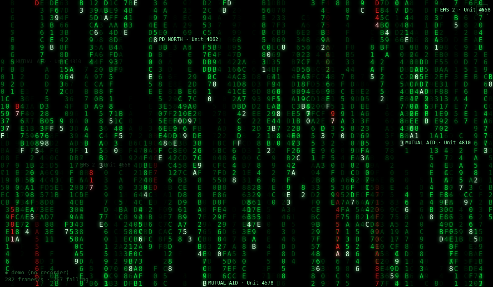

# Vocoder Rain

A Trunk Recorder Pro interface that shows live digital voice as falling vocoder frames: each
20 ms IMBE or AMBE+2 frame falls as one streak of its own information bits, in hex (or kana,
or bits). The head of a streak is bright, the trail fades. Damaged frames (repeated, muted,
lost) fall in red. Frames the FEC had to correct flicker, more with more errors. Tags on the
heads name the talkgroup and the radio talking.

It's a novelty. It needs a Trunk Recorder Pro whose interface API sends vocoder frames
(`listen` with `voice: true`, a `voice` message per live audio chunk): newer than 0.3.6.
Analog calls have no frames, so only digital voice falls.

## Install

Once it's in the interface store: **Find interfaces** on the Interfaces page, or
`trunk-pro interface install trunk-rain`. Before that, `trunk-pro interface install
https://github.com/taclane/trunk-rain` installs its latest release, or serve the `interface/`
folder of a clone as below.

## Use

Add the `interface/` folder on the Interfaces page (**Add a folder…**), or run
`trunk-pro interface add interface/`, and open it. The ⚙ button has the options. Any option
also works in the address, for a wall display: `?color=tg&glyphs=kana&size=20&tags=tg`.

`?demo` runs it on made-up frames without a recorder. Add `&warm=4` to start with 4 seconds
of rain already fallen.

| Option | Values |
|---|---|
| `tags` | `both`, `tg`, `unit`, `off` |
| `tagEvery` | `sec`, `tx` (each transmission), `drop` (each frame) |
| `color` | `classic`, `tg`, `unit`, `codec` |
| `glyphs` | `hex`, `kana`, `bits` |
| `speed` | rows a second, 4–60 |
| `size` | glyph size, px |
| `bad`, `flicker`, `sound` | `1` / `0` |
| `tgFilter` | a talkgroup number (filtered at the recorder) or text to match its alpha tag |

## Development

`node --test test/*.test.mjs` runs the tests (how a `voice` message becomes falling glyphs).
`.github/package.sh` checks `interface/interface.json` and builds a release into `dist/` as CI
does. Pushing a tag `v<version>` (the version in `interface.json`) publishes the release.
